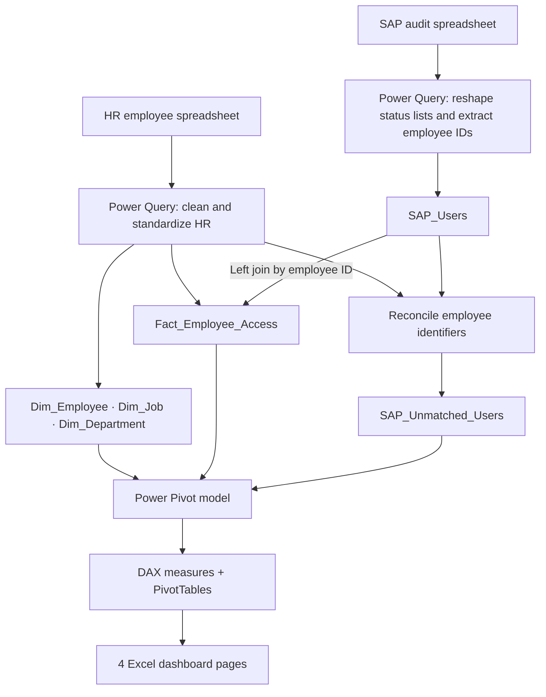
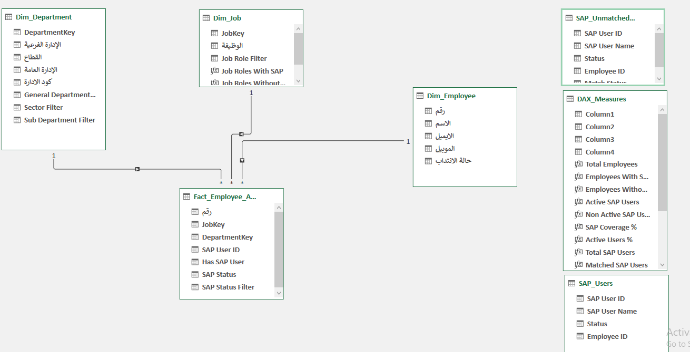
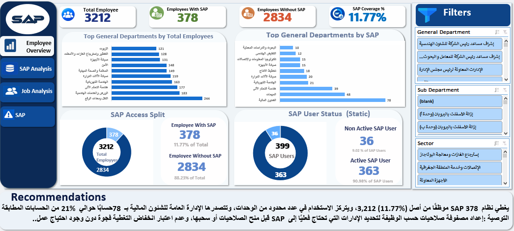
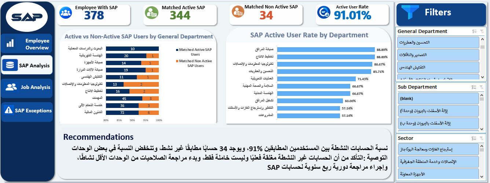
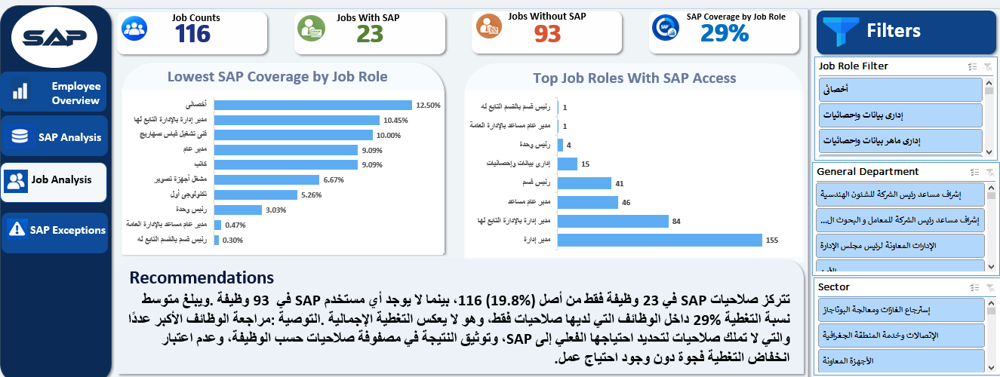
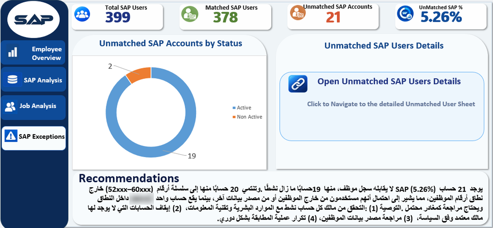

# Employee Workforce & SAP Access Analytics

**Excel BI case study | HR–SAP reconciliation, workforce insights and access-review prioritization**

**Tech stack:** Microsoft Excel · Power Query (M) · Power Pivot · DAX · PivotTables · PivotCharts · Slicers  
**Deliverables:** 3 interactive analysis dashboards + 1 pivot-backed SAP Exceptions summary · dimensional data model · SAP reconciliation analysis · downloadable Excel workbook

> **Scope:** This is a historical analysis of two spreadsheet extracts, not a direct live connection to SAP. An unmatched account is a *reconciliation exception*, not proof of unauthorized access. Public-facing screenshots show analytical summaries; the workbook may contain underlying records and should be shared only after checking its publication permissions and stored data.

## At a glance

| Workforce | SAP accounts | Employee SAP coverage | Unmatched SAP accounts |
|---:|---:|---:|---:|
| **3,212** | **399** | **11.77%** | **21 (5.26%)** |

**Key finding:** **19 of 21 unmatched SAP accounts** are marked Active in the source extract and should receive priority *identity validation*.

**Explore the interactive workbook:** [Employee SAP Project.xlsx](workbook/Employee%20SAP%20Project.xlsx) — Microsoft Excel desktop is recommended for the best experience with Power Query, Power Pivot, PivotTables and slicers. If this repository is public, anyone can download the workbook; share only a version approved for public distribution.

## Contents

1. [Project overview](#1-project-overview)
2. [Business problem](#2-business-problem)
3. [Business objectives](#3-business-objectives)
4. [Data sources and scope](#4-data-sources-and-scope)
5. [Tools and responsibilities](#5-tools-and-responsibilities)
6. [End-to-end architecture](#6-end-to-end-architecture)
7. [Data cleaning and transformation](#7-data-cleaning-and-transformation)
8. [Data model and relationships](#8-data-model-and-relationships)
9. [KPIs and DAX logic](#9-kpis-and-dax-logic)
10. [Dashboard walkthrough](#10-dashboard-walkthrough)
11. [Insights and recommendations](#11-insights-and-recommendations)
12. [Technical decisions, limitations and next steps](#12-technical-decisions-limitations-and-next-steps)

## 1. Project overview

This project brings together **HR employee records** and **SAP account audit extracts** in an Excel-based analytics solution. I prepared and standardized the source data in Power Query, modeled it in Power Pivot, created reusable DAX measures, and built **four dashboards** for workforce coverage, account status, job-role analysis and a pivot-backed reconciliation-exceptions summary.

**Business outcome:** a reproducible analytical view that helps HR/IT prioritize which SAP identities to investigate. Recommendations were proposed, **not implemented or proven to reduce risk** within this project.

## 2. Business problem

HR and SAP exports describe related people and accounts but use different source layouts and identifiers. When these data sources are examined separately, it is harder to answer:

- How many employees have an SAP account matched to the HR roster?
- Which departments and job roles have SAP access, and how does status vary?
- Which SAP accounts have **no identifiable HR match**?
- Which exceptions should the business validate first?

**Importantly, 100% SAP coverage is not the goal.** Access should be justified by employee duties and approved authorization rules.

## 3. Business objectives

| Objective | Analytical question | KPI / output |
|---|---|---|
| Establish a reliable workforce baseline | How many employees remain after cleaning? | Total Employees |
| Measure workforce access coverage | What proportion of employees has an SAP match? | Employees With/Without SAP; SAP Coverage % |
| Understand account status | How many accounts are marked Active vs Non Active? | Active / Non-Active SAP; Matched Active Rate |
| Compare across functions | Where is access concentrated? | Department charts; job-role counts and coverage |
| Reconcile systems | Which SAP IDs are not found in the HR roster? | Unmatched SAP Accounts and Unmatched SAP % |
| Inform access review | Which exceptions deserve verification first? | Active unmatched accounts; recommended review workflow |

## 4. Data sources and scope

| Source | Key attributes | Expected grain |
|---|---|---|
| **HR workforce spreadsheet** | Employee ID (`رقم`), name, email, phone, job title, organizational hierarchy | One employee per unique employee ID in the analysis |
| **SAP audit spreadsheet** | SAP User ID, SAP User Name, status (Active / Non Active) | One SAP account per record |

The HR source began with **3,215 rows**. Removing **3 fully duplicated rows** yielded **3,212 employee records**. The SAP audit snapshot contains **399 accounts**. Reconciliation uses the HR employee ID and an employee identifier parsed from the SAP user ID.

**Publication scope:** The separate raw HR and SAP source exports are not included in this repository. The downloadable Excel workbook may nevertheless contain stored/transformed records, model data, query definitions and caches. Its full contents must be checked against publication authorization before upload.

**Grain consideration:** The main fact is used for employee-level reporting. Multiple SAP accounts for one employee would require a reassessment of join cardinality and distinct employee counts.

## 5. Tools and responsibilities

| Technology | Role in the solution |
|---|---|
| **Excel** | Dashboard presentation, PivotTables, PivotCharts, slicers and navigation |
| **Power Query (M)** | Data import, standardization, cleansing, appends, joins and exception extraction |
| **Power Pivot** | Central fact, dimensions, relationships and in-workbook semantic model |
| **DAX** | Reusable KPIs calculated under report filter context |

This project **did not use SQL, Python or Power BI**. The Excel BI stack was appropriate for spreadsheet sources and the requested interactive workbook deliverable.

## 6. End-to-end architecture



**Modeling detail:** The three dimensions relate to the central fact table in Power Pivot. The supporting `SAP_Users` and unmatched-exceptions tables are kept separately; the HR–SAP matching itself was implemented in **Power Query**, not with a direct SAP-to-fact Power Pivot relationship.

## 7. Data cleaning and transformation

The steps below are based on the workbook's **embedded Power Query M definitions**. They represent transformations performed in the project, rather than generic ETL claims.

### 7.1 Employee data

| Source challenge | Transformation | Why it matters |
|---|---|---|
| Extra sequencing column | Removed the non-analytical source index | Kept the model focused on relevant fields |
| Extra spaces and invisible characters | Used `Text.Trim` and `Text.Clean` on relevant text and identifiers | Improved matching and grouping consistency |
| Inconsistent email text | Lowercased email, stripped spaces, standardized the expected email domain | Reduced format differences in this source |
| Different phone-number formats | Removed punctuation/spaces and normalized `+20` prefix to `0` | Improved phone formatting consistency |
| Inconsistent job-title text | Cleaned Arabic elongation characters, spacing and punctuation | Reduced duplicate-looking job categories |
| Secondment wording mixed into job titles | Derived a separate **secondment status** field and cleaned the base role name | Preserved an HR attribute without fragmenting roles |
| Variations in organization labels | Standardized department, sector and sub-department names | Supported consistent filtering and aggregation |
| Duplicate employee rows | Applied `Table.Distinct` in the final employee preparation | Avoided inflating the employee population |

**Check:** 3,215 source rows → **3,212** after removing three fully duplicated rows. Whole-row deduplication is not equivalent to a unique-key validation; that distinction matters for future data refreshes.

### 7.2 SAP account preparation

1. Created separate **Active** and **Non Active** account queries from the SAP source layout.
2. Standardized their columns to `SAP User ID` and `SAP User Name`.
3. Added a status label to each branch and removed rows without a usable SAP ID.
4. **Appended** both branches into `SAP_Users`.
5. Parsed `Employee ID` from the portion of `SAP User ID` following a period (`.`).
6. Applied identifier and name cleaning before joining to HR.

**Why?** A single status-labeled account table makes account totals and comparisons reproducible, while the extracted employee identifier provides the cross-system reconciliation key.

### 7.3 Model preparation and integration

- Built **`Dim_Employee`** from cleaned employee attributes.
- Built **`Dim_Job`** from distinct role names, adding a surrogate `JobKey`.
- Built **`Dim_Department`** from distinct organization combinations, adding a `DepartmentKey` and display-friendly filter columns.
- Constructed **`Fact_Employee_Access`** using **three left-outer merges**: with the job dimension, department dimension, and SAP users table.
- Derived `Has SAP User` and `SAP Status` to distinguish matched from non-matched employee records.
- Built the independent **`SAP_Unmatched_Users`** query using HR matching to identify SAP accounts absent from the cleaned HR roster.

A representative M-code step from the original workbook:

```powerquery
#"Merged Queries2" = Table.NestedJoin(
    #"Removed Other Columns", {"رقم"},
    SAP_Users, {"Employee ID"},
    "SAP_Users", JoinKind.LeftOuter
)
```

**Why left-outer joins?** Employee-to-SAP matching retains HR records **without** SAP accounts. The reverse reconciliation query independently keeps SAP accounts **without** an HR match. These are different business populations and should not be mixed.

See [ETL notes](docs/ETL_NOTES.md) for transformation reasoning and quality risks.

## 8. Data model and relationships



| Table | Model purpose |
|---|---|
| `Fact_Employee_Access` | Central employee/access table: employee ID, job and department keys, access flag, SAP status |
| `Dim_Employee` | Employee attributes, keyed by employee ID |
| `Dim_Job` | Unique job roles and `JobKey` |
| `Dim_Department` | Organizational hierarchy and `DepartmentKey` |
| `SAP_Users` | Supporting complete SAP-account extract |
| `SAP_Unmatched_Users` | Independent unmatched-account exception table |
| `DAX_Measures` | Container for reusable measures |

**Visible 1-to-many relationships:**

- `Dim_Employee (1)` → `Fact_Employee_Access (*)`
- `Dim_Job (1)` → `Fact_Employee_Access (*)`
- `Dim_Department (1)` → `Fact_Employee_Access (*)`

**Why a star-schema-inspired approach?** It separates reusable employee, role and department descriptions from the central access analysis, supports slicing and reduces repetitive attributes. Because SAP users and exceptions are separate supporting tables, this is **not** claimed to be a single strict star schema.

## 9. KPIs and DAX logic

| KPI | Calculation / interpretation | Result |
|---|---|---:|
| Total Employees | Cleaned employee records | **3,212** |
| Employees With SAP | HR employees matched to SAP | **378** |
| Employees Without SAP | Total Employees − Employees With SAP | **2,834** |
| SAP Coverage % | 378 ÷ 3,212 | **11.77%** |
| Total SAP Accounts | All SAP accounts in audit extract | **399** |
| Active / Non-Active SAP Accounts | Source-reported account status | **363 / 36** |
| Matched Active / Non-Active | Matched HR–SAP accounts | **344 / 34** |
| Matched Active Rate | 344 ÷ 378 | **91.01%** |
| Unmatched SAP Accounts | SAP accounts with no HR match | **21** |
| Unmatched SAP % | 21 ÷ 399 | **5.26%** |
| Unmatched Active / Non-Active | Status of unmatched SAP accounts | **19 / 2** |
| Total Job Roles | Distinct roles in job dimension | **116** |
| Job Roles With / Without SAP | Job roles with vs without employees holding a matched account | **23 / 93** |
| Avg SAP Coverage by Job Role | Unweighted mean of role-level coverage values included by `AVERAGEX` | **29.09%** |

**Actual DAX — overall SAP coverage:**

```dax
SAP Coverage % =
DIVIDE(
    [Employees With SAP],
    [Total Employees],
    0
)
```

**Actual DAX — average coverage by job role:**

```dax
Average SAP Coverage by Job Role =
AVERAGEX(
    VALUES(Dim_Job[الوظيفة]),
    [SAP Coverage %]
)
```

**Interpreting the 29.09% correctly:** This `AVERAGEX` measure averages coverage calculated within each job-role filter context; **blank results are skipped**. It is *not* the percentage of roles having at least one SAP user. That separate statistic is **23 / 116 = 19.83%**. The two measures answer different questions. This describes the displayed result and formula, not an independent row-by-row recalculation of the measure.

Another important distinction: **363 / 399 = 90.98%** is the overall account active rate, while **344 / 378 = 91.01%** is the active rate *among matched accounts*.

See [KPI dictionary](docs/KPI_DICTIONARY.md) for a compact business-to-measure map.

## 10. Dashboard walkthrough

### 10.1 Employee Overview



**Business question:** What is the workforce SAP-access footprint, and where is matched access concentrated?

**Finding:** **378 of 3,212 employees** have matched SAP accounts (**11.77%**); **2,834** have no matched account. This is descriptive, not evidence that everyone else needs SAP access.

### 10.2 SAP Analysis



**Business question:** What is the Active / Non Active status composition of matched SAP accounts, and how does it vary by department?

**Finding:** **344 matched accounts** are marked Active and **34** Non Active, yielding a **91.01%** matched active rate. *Active status is not a login-activity metric.*

### 10.3 Job Analysis



**Business question:** Which roles have matched SAP access, and how does access coverage vary across roles?

**Finding:** **23 of 116** roles have at least one SAP-matched employee. The separately calculated **29.09%** is an **average of eligible role-level coverage percentages**, not the 23/116 ratio. Access gaps need evaluation against role requirements.

### 10.4 SAP Exceptions



**Business question:** Which SAP accounts fail HR reconciliation and need identity verification?

**Finding:** **21 of 399 accounts (5.26%)** are unmatched: **19 Active** and **2 Non Active**. The doughnut chart displays the status distribution of the unmatched-account population; these counts are supplied by the underlying PivotTables.

**Page interaction:** The final SAP Exceptions page intentionally has **no status slicer**. Its KPI cards and doughnut chart are linked to PivotTables and summarize the complete reconciliation snapshot. The **Open Unmatched SAP Users Details** control navigates to the detailed unmatched-account sheet in the Excel workbook; the image itself is a static preview. The workbook owner confirmed that the control works in the final local version.

> **Screenshot and workbook disclosure:** The updated Exceptions screenshot is cropped from the final page provided by the project owner; one account identifier is obscured for public preview. The visible KPIs, chart distribution and recommendation wording remain unchanged. The Excel workbook may contain additional model, hidden-sheet, query or cache data and requires permission and privacy checks before public distribution.

## 11. Insights and recommendations

| Finding | Business interpretation | Proposed action |
|---|---|---|
| **21 of 399** accounts lack an HR match (**5.26%**) | Cross-system identity exceptions exist | Reconcile against an authoritative HR/identity source |
| **19 of those 21** are marked Active | Prioritize verification of potentially usable unmatched identities | Confirm account owner, identity type and business sponsor |
| **34 matched accounts** are Non Active | Account status differs among matched staff | Check whether status matches role and lifecycle expectations |
| **378 of 3,212** employees have a matched SAP account | Access is concentrated in part of the workforce | Review against a role-based entitlement matrix, not a universal target |
| Only **23 of 116 roles** have SAP-matched employees | Role-level access patterns vary | Compare access patterns with approved job-role needs |

**Exceptions-page recommendations (retained from the final workbook):**

1. Verify the owner and authorized purpose of each **Active unmatched account** with HR and IT.
2. Where no authorized owner can be established, escalate for a policy-approved access decision; disable accounts **only after appropriate authorization and verification**.
3. Recheck the HR employee-source coverage and the employee-ID extraction/matching rules, especially for IDs outside the normal HR number range.
4. Repeat SAP-to-HR reconciliation periodically and track unresolved accounts through an owner-reviewed follow-up process.

**Additional observation from the page narrative:** 20 unmatched IDs appear in a `52xxx–60xxx` numbering pattern outside the reported HR employee-ID range, while one lies within the range. This pattern is a **lead for investigation, not proof** of external or unauthorized access; it has not been independently revalidated against the latest workbook.

These are **recommendations only**; the project does not demonstrate that remediation was completed, quantify financial savings, or establish unauthorized access.

## 12. Technical decisions, limitations and next steps

### Decisions and trade-offs

| Choice | Reasoning | Trade-off / limitation |
|---|---|---|
| **Power Query instead of manual edits** | Recorded, repeatable transformations and merges | Refresh is sensitive to file paths, data types and changing source layouts |
| **Excel + Power Pivot** | Keeps transformations, model, DAX and dashboards in one deliverable | Not a replacement for centralized data governance or production audit tooling |
| **Fact + dimensions** | Consistent slicing by employee, job and department | Requires unique keys, join validation and explicit grain definitions |
| **Employee-ID extraction from SAP ID** | Connects exports without an existing cross-system lookup table | Relies on a stable SAP naming convention and valid HR IDs |
| **Independent unmatched-account query** | Enables reconciliation in the reverse direction | Detached status filters do not automatically affect KPIs based on other tables |
| **Source-reported Active status** | Available in supplied audit data | Does not prove last login, usage, privilege level or actual entitlement |

**Why no SQL or Python?** The assignment and sources were Excel-based; Power Query supplied the required data preparation, and Power Pivot supplied the relational model. SQL might be preferable for database-backed history and scalable joins; Python could help with automated anomaly checks. Neither is claimed as part of this implementation.

### Limitations and checks

- **Counts:** `3,212 = 378 + 2,834`; `399 = 363 + 36`; `378 = 344 + 34`; `399 = 378 + 21`; `21 = 19 + 2`.
- **Account cardinality:** Confirm one-to-one employee/account assumptions before using raw row counts as unique-person counts.
- **Identifier sensitivity:** Leading zeroes, IDs not using the `.` separator, or inconsistent HR formats may change match results.
- **Date and activity:** The files provide a snapshot, not login logs or a longitudinal audit trail.
- **Security interpretation:** An unmatched account is a *review candidate*, not a confirmed violation.
- **Privacy:** Review the workbook’s visible/hidden sheets, query definitions, stored model records, caches, connections, metadata and personal identifiers. Publish only information explicitly covered by permission; separate source exports remain excluded.

### Repository layout

```text
employee-workforce-sap-access-analytics/
├── README.md
├── workbook/
│   └── Employee SAP Project.xlsx
├── images/
│   ├── employee_overview.png
│   ├── sap_analysis.png
│   ├── job_analysis.png
│   ├── sap_exceptions.png
│   └── data_model.png
├── docs/
│   ├── ETL_NOTES.md
│   └── KPI_DICTIONARY.md
└── .gitignore
```

**How to explore:** Read the problem and objectives → follow the Mermaid data flow → inspect Power Query logic and relationships → compare KPI definitions with dashboard snapshots → [open the Excel workbook](workbook/Employee%20SAP%20Project.xlsx) for interactive inspection → review recommendations and limitations. Reproducing source refreshes requires access to approved source extracts, which are not provided here.

### Next steps

1. Define and test key uniqueness, join cardinality and refresh checks.
2. Add a dated reconciliation log with owner and resolution status for each exception.
3. Keep the **SAP Exceptions** page as an intentionally unfiltered, PivotTable-backed audit summary; verify its 19/2 chart split and overall cards after future refreshes.
4. Optionally prepare a separate synthetic/anonymized workbook for demos where organizational records cannot be shared.
5. Introduce historical tracking once repeated extracts and approved access are available.

---

**Portfolio takeaway:** This case study demonstrates the complete analytical chain—from **messy source records** to **structured ETL**, **relational modeling**, **DAX**, **interactive dashboards**, and **business-aware exception review**—while keeping limitations and privacy visible.
